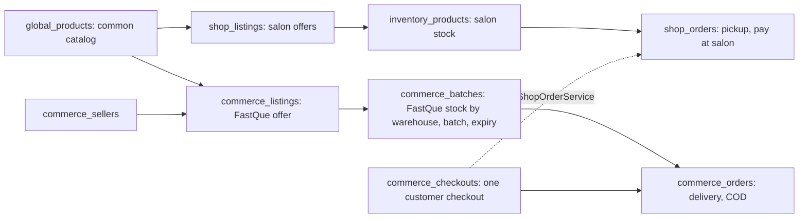
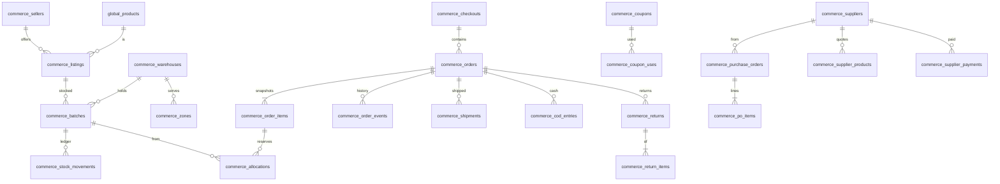

# FastQue Direct Commerce

Products FastQue sells itself, delivered with Cash on Delivery, beside the existing salon marketplace
(`docs/shop/MARKETPLACE.md`), which is unchanged. No online payment exists anywhere in this feature.

## Protection: what existing code changed

Recovery checkpoint: `8965d964` (tag `checkpoint/direct-commerce-base`).

| Existing file | Change | With flags off |
| --- | --- | --- |
| `backend/src/app.module.ts` | imports `CommerceModule` | routes answer 404 (except `commerce/config`) |
| `backend/src/shop/shop.module.ts` | exports `ShopOrderService` | no change |
| `backend/src/notifications/notifications.service.ts`, shared `types`, `i18n`, web `NotificationBell` | five notification types | never sent |
| `prisma/schema.prisma` | `GlobalProduct.commerceListings` back-relation, 44 new models | no change |
| web `ShopParts`, `ShopHome`, `ShopBrowse`, `ShopProduct`, `ShopCheckout`, `CustomerShop`, `shop/bag` | insert components that render nothing while off | one extra request to `commerce/config` |
| web `lib/shop/store.ts` | adds `bag.addAny` | not called |
| web `admin-nav` (Customer Support is now a live tab), `admin-route-access`, `dashboard-flags` | admin section | hidden |

No existing table, column, endpoint, response or shared style was changed. Salon prices, stock,
reservations, the 24-hour window, cancellation and expiry still run in `ShopOrderService` / `shop-stock`.

## Flags

All off unless exactly `true`. The first backend flag gates the rest.

| Flag | Turns on |
| --- | --- |
| `FASTQUE_DIRECT_COMMERCE_ENABLED` | the API, storefront and order pages |
| `MULTI_SELLER_CART_ENABLED` | one checkout for FastQue plus several salons |
| `FASTQUE_COD_ENABLED` | ordering (COD is the only payment method) |
| `FASTQUE_DELIVERY_ENABLED` | delivery zones; off = nowhere is serviceable |
| `FASTQUE_RETURNS_ENABLED` | customer return requests |
| `FASTQUE_COMMERCE_AI_ENABLED` | rule-based insights |
| `NEXT_PUBLIC_FASTQUE_DIRECT_COMMERCE_ENABLED` (web, build time) | admin sidebar section |

Guest order links use `SHOP_ORDER_TOKEN_SECRET`, falling back to `JWT_ACCESS_SECRET`, as salon orders do.

## Architecture

`commerce_sellers` holds FastQue as its own seller (`type = FASTQUE`, never a salon). The types
DISTRIBUTOR, MANUFACTURER, BRAND and WHOLESALER exist for later. Salon sellers are not copied: a row with
`salonId` can link one when needed, and a database CHECK keeps `SALON` and `salonId` together.

## Workflows

**Order.** PLACED → CONFIRMED → (PROCESSING) → PACKED → SHIPPED → OUT_FOR_DELIVERY → DELIVERED. Customers may
cancel before PACKED. DELIVERY_FAILED can be retried or become RETURN_TO_ORIGIN → RETURNED. The server refuses
every other change (`COMMERCE_TRANSITIONS`).

**Stock.** RESERVE at placement (first expiry first, row-locked) → DISPATCH at SHIPPED, or RELEASE on cancel.
Returned units enter quarantine and are inspected before RESTOCK or write-off; damaged, expired or defective
returns can never be restocked. CHECK constraints forbid negative stock and reserved > on hand. The stock,
order-history and cash ledgers reject UPDATE and DELETE. Available = on hand − reserved, unexpired only.

**Checkout.** Everything is validated first; FastQue is placed in one transaction, then each salon through
`ShopOrderService`. If a later seller fails, what was placed is cancelled and the customer is told. One
`Idempotency-Key` gives one result. If a compensation itself fails, the customer is told part of the order may be
open and the server logs an error. Limits: 5 open COD orders per phone.

**COD.** Delivery never means paid. Finance records COLLECTED → SETTLED (with courier deductions) → optional
ADJUSTMENT (reason required) → sign-off. Sign-off needs settled + adjustments = order total, and by a different
person if an adjustment was recorded.

**Procurement.** DRAFT → APPROVED (finance) → ORDERED → goods receipt with accepted/rejected quantities →
RECEIVED. Only accepted units become stock. Supplier balance = accepted value − payments. Purchases are not
copied into Finance expenses, so they are not counted twice; book them there by your accounting policy.

**Serviceability.** Zones match full PINs or PIN prefixes; blocked PINs win. No zone = no delivery.

**Offers.** One table: buy X get Y, bundle price, percent, each optionally limited to PIN areas. The server applies the
best saving first and never puts one product in two offers. A coupon works on what is left. The offer is stored on the
order, so a refund returns what was really paid for each product. Offers below cost need a confirmation.

**Reviews.** One per delivered order line; staff publish or hide. **Support.** A request belongs to an order (seller, product
and shipment are linked). Messages are append-only; internal notes are never sent to the customer. It does not use the
employee CRM's `SupportTicket`, which needs a staff creator and cannot hold a guest's request.

**Photos.** Return photos and delivery proof are decoded, re-encoded without location data and kept in private storage. Only
staff with the orders permission can open them.

**Imports.** Stock and courier settlement files (CSV, XLSX) are previewed first. Stock is all or nothing and one file works
once. Settlement lines match one delivered order with the exact amount due; applying records collected and settled
cash, never the sign-off.

**Stock counts.** Blind count, approved by a different person; only the difference seen at counting time is posted, so stock
received afterwards is kept.

**Procurement.** Request → quotations → finance approval → draft purchase order. Returns to suppliers leave through the
ledger; finance records the credit, which lowers the balance.

**Warehouse limits.** No limit = all warehouses. Limits apply to stock in, adjust, transfer, history, receive, counts, pickups,
import, bulk steps and the batch list. A single order opened from the Orders tab is not limited by warehouse.

**Forecasts and suggestions.** A weighted weekly average with its range, shown only with at least four weeks of history; price
suggestions never below cost or above MRP; unusual-order patterns; a reply drafted from the order's own records. Nothing
changes a price, orders stock, blocks a customer or sends a message by itself.

**Documents.** Bills, packing slips, address labels and purchase orders open as print pages ("Save as PDF" in the browser).
Labels carry no courier barcode.

## API

Public `commerce/`: `config`, `home`, `products`, `products/:id`, `products/:id/offer`, `sitemap-products`,
`serviceability?pin=`, `POST quote`, `POST checkout` (Idempotency-Key), `orders/:number?token=`, `…/cancel`,
`…/returns`. Customer `customer/commerce/`: `checkout`, `orders`, `orders/:number` (+`cancel`, `returns`),
`addresses`. Admin `admin/commerce/`: `me`, `overview`, `insights`, `data-quality`, `seller`, `grants`,
`catalog`, `listings`, `warehouses`, `stock`, `batches` (+`adjust`, `transfer`, `movements`), `zones`,
`coupons`, `orders` (+`transition`, `invoice`, `cod`, `reconcile`), `cod`, `returns`, `suppliers`,
`purchase-orders`, `export/orders`. Added: public `banners`, `listings?ids=`, `products/:id/reviews|details`, `events`,
`orders/:number/invoice|reviews|tickets|returns/:id/photos`; customer the same plus `bag`, `recommendations`; admin
`reviews`, `tickets`, `promotions`, `listings/:id/detail`, `banners`, `return-policies`, `orders/:id/files|proof`, `files/:id`,
`warehouse-grants`, `stock/import`, `audits`, `settlements`, `orders-bulk`, `export/orders-xlsx`, `purchase-requests`,
`purchase-orders/:id/document`, `supplier-returns`, `pickups`, `forecast`, `price-suggestions`, `risk-signals`, `reports`,
`stock-alerts`. Schemas: `commerce-extras.ts`. Schemas: `packages/shared/src/commerce.ts`.

## Permissions

PLATFORM_ADMIN has all. Other internal admins need a grant per permission (Settings); `settings` cannot be granted.

| Role in the brief | Grants |
| --- | --- |
| Commerce admin | view, catalog, orders, delivery, support |
| Warehouse manager / staff | view, warehouse |
| Procurement manager | view, procurement |
| Finance manager | view, finance (refunds, COD, PO approval, profit and cost) |
| Customer support | view, orders, support |
| Delivery operations | view, orders, delivery |
| Salon owner, customer | none: 403 on every admin route |

Costs, suppliers and profit are only sent to `finance` / `procurement`. Warehouse work can be limited per warehouse in Settings.

## Deploy and roll back

1. Merge with all flags off; the pre-deploy `prisma migrate deploy` adds tables only.
2. Set the seller details, warehouse, zone, products and stock (backend flag on, COD and delivery off).
3. Review **Product data quality** and mark sample products as test data (reversible; nothing is deleted).
4. Turn on delivery, COD, then multi-seller.

Roll back by turning flags off. Keep the tables: dropping them would lose orders, stock and cash records.

## Test evidence

See `docs/commerce/TEST_RESULTS.md`. Tests: `packages/shared/src/__tests__/commerce*.test.ts`,
`apps/backend/test/commerce.e2e-spec.ts`, `apps/backend/test/commerce-extras.e2e-spec.ts` (disposable database `owner_ops_chain` or `commerce_ci`).

## Completion matrix

V = implemented and verified (e2e and/or browser) · N = implemented, not verified in the browser or by a dedicated test ·
X = needs external configuration · — = not implemented.

| Area | V | N | X | Not implemented (—) |
| --- | --- | --- | --- | --- |
| Flags, legacy unchanged | all six flags | | | |
| Sellers | FastQue seller, isolation | future seller types | | unified salon seller rows, distributor portal |
| Catalog | shared master product, test data excluded, details, variant groups | | | |
| Storefront | storefront, cards, comparison, PIN check, reviews, banners, bundles, recently viewed, suggestions from own orders | photo gallery and zoom (no product photos in the test data), filters, best sellers | | |
| Bag and checkout | mixed bag, guest COD, offers, billing address form, saved addresses, account bag, compensation | save for later | | |
| Orders | state machine, snapshots, guest links, FEFO, cancel, bulk steps, Excel export, bills, slips, labels, abandoned-bag count | CSV export button | courier labels | reminders to customers with abandoned bags |
| Inventory | batches, ledger, reserve, expire, quarantine, transfer, adjust, file import, blind counts, warehouse limits | camera scan on a real phone (off unless `NEXT_PUBLIC_INVENTORY_CAMERA_SCAN=true`) | | |
| Procurement | requests, quotations, PO, approval, partial receipt, rejects, balances, payments, supplier returns and credits, PO document | supplier prices form | | |
| Shipping | manual shipments, attempts, RTO, pickups, proof photo | | courier APIs and live tracking | |
| COD | collect, settle, adjust, second-person sign-off, settlement file matching | | | |
| Returns | window, quarantine, inspection, refund record, replacement, photos, category rules | admin returns screen | | |
| Notifications | in-app outbox, salon order alerts, support replies, daily stock alerts | | email, SMS, WhatsApp | |
| Pricing, promotions | coupons, below-cost and MRP guards, BOGO, bundles, area offers | promotion window fields, brand/category coupons | | |
| Support | order requests, internal notes, assignment, suggested reply | | | |
| Reports | direct vs salon kept apart, cost protected, retention, value per customer, warehouses, views to orders | charts, date ranges | | per-person funnel (no visitor tracking, on purpose) |
| Insights | rules with stated basis, forecast, price and risk suggestions | | | language-model agents (no paid AI dependency, on purpose) |
| Data quality | audit, reversible marking | | | clean-up run on production (needs approval) |
| Invoices | print-ready bill | | GSTIN, legal name, address; GST invoice number series (accountant) | |
| Mobile apps | | | | no shop screens exist in the apps |
